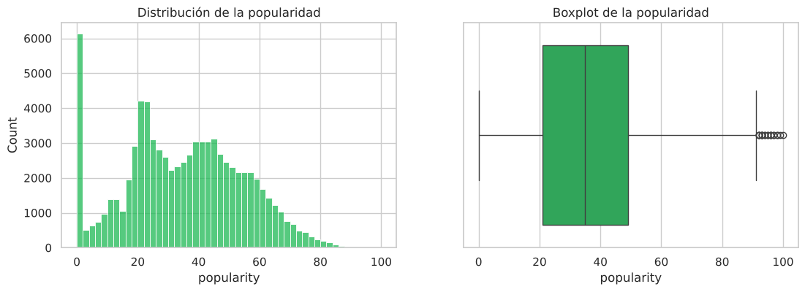
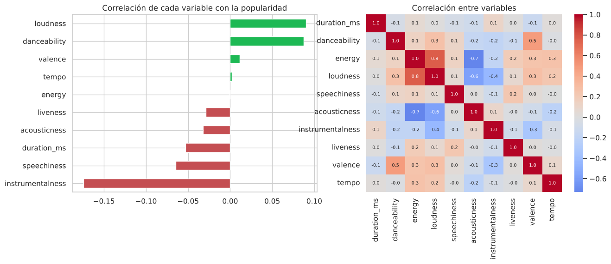
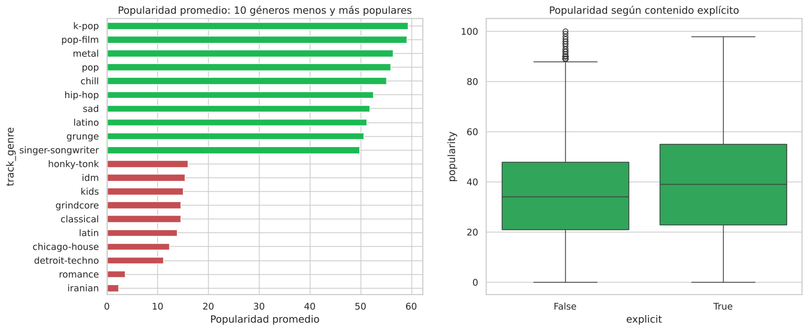
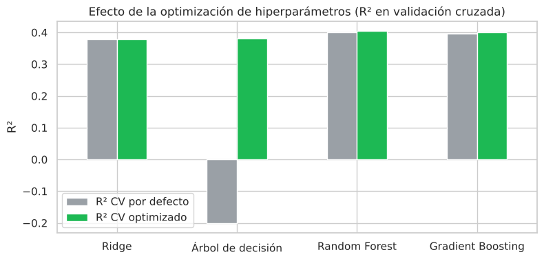
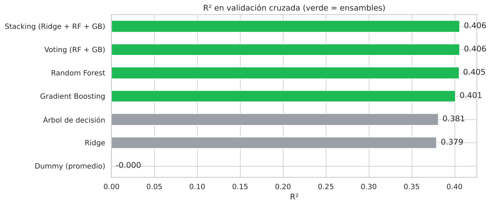
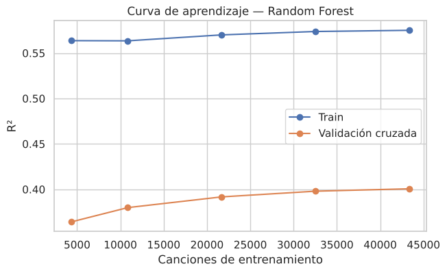
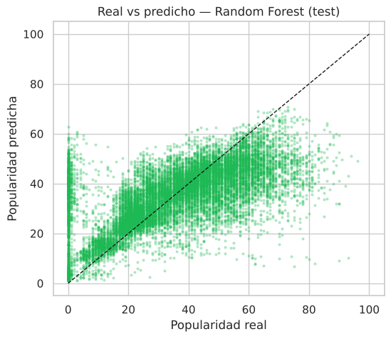
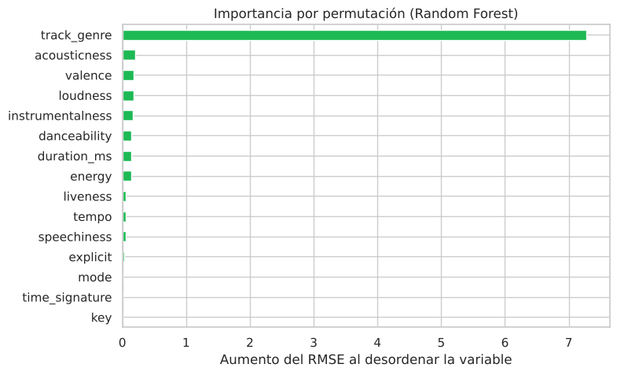
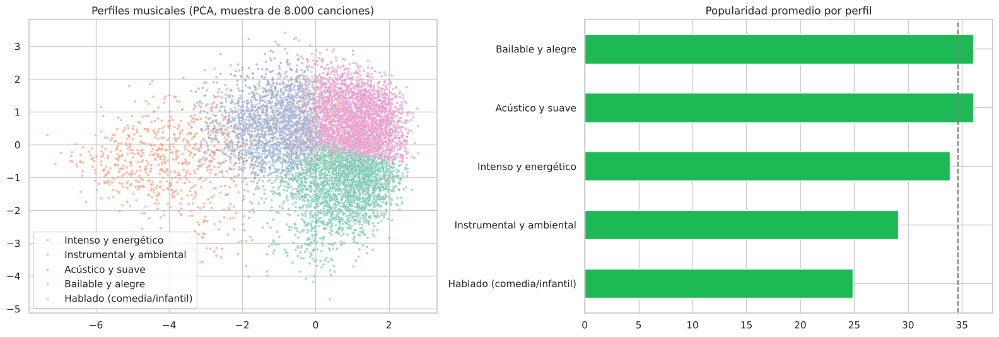

# Predicción de popularidad de canciones — Spotify Tracks

**MLY1101 Machine Learning · Evaluación Parcial N°3 · Caso C**
**Integrantes:** Nicolás Garrido · Karen Manríquez · Felipe Espinoza

Este es el informe de nuestro proyecto. Todo el código está en [`notebooks/spotify_popularidad.ipynb`](notebooks/spotify_popularidad.ipynb) y los gráficos en [`images/`](images/).

---

## Resumen

- Predecimos la **popularidad** de una canción (0–100) a partir de sus características musicales y su género. Es un problema de **regresión**.
- Elegimos el modelo con una **regla definida antes de ver el test**. El ganador es el **Random Forest optimizado**: **R² 0,415** y **error promedio de 10,4 puntos** en test.
- Lo más útil para el negocio: del **10 % de canciones con mayor predicción, el 72 % son hits**, 3 veces mejor que elegir al azar.
- El **género** es por lejos lo que más influye en la popularidad.
- Con **K-Means** encontramos 5 perfiles musicales: los **bailables** y **acústicos** son los más populares, y los **instrumentales** y **hablados**, los menos.

---

## 1. Problema de negocio

Un sello discográfico o un equipo de curadores de playlists recibe miles de canciones y no puede promocionarlas todas. Necesita **estimar qué tan popular puede ser una canción** para decidir dónde poner su presupuesto de marketing y qué temas proponer a las playlists.

## 2. Objetivos

**Objetivo general:** construir un modelo que estime la popularidad de una canción a partir de sus características musicales y su género.

**Objetivos específicos:**
1. Explorar los datos y encontrar qué variables se relacionan con la popularidad.
2. Entrenar y comparar modelos de regresión, optimizando sus hiperparámetros con validación cruzada.
3. Probar técnicas de ensamble (bagging, boosting, voting y stacking) y medir si mejoran el resultado.
4. Evaluar si el modelo generaliza a canciones nuevas.
5. Agrupar las canciones con K-Means para encontrar perfiles musicales.

## 3. KPIs y regla de selección

| KPI | Meta | Resultado |
|---|---|---|
| R² en test | ≥ 0,40 | **0,415 ✓** |
| MAE (error promedio en puntos) | ≤ 11 | **10,36 ✓** |
| Mejora del RMSE frente al modelo base | ≥ 20 % | **23,5 % ✓** |
| Diferencia de R² entre validación cruzada y test | ≤ 0,02 | **0,010 ✓** |
| % de hits en el 10 % con mayor predicción | ≥ 60 % | **72 % ✓** |

**Regla para elegir el modelo (definida antes de modelar):** gana el mayor R² en validación cruzada; si otros modelos quedan a menos de 0,005 del mejor, se elige el más simple. El test solo se usa para confirmar, nunca para elegir.

## 4. Fuente de datos

Dataset **Spotify Tracks** (Kaggle, obtenido de la API de Spotify), entregado por la asignatura: [`data/Spotify_Tracks_Dataset.csv`](data/Spotify_Tracks_Dataset.csv).

Tiene **114.000 filas y 21 columnas**: identificación de la canción (`track_id`, `artists`, `album_name`, `track_name`), la popularidad (0–100), características de sonido calculadas por Spotify (`danceability`, `energy`, `acousticness`, `instrumentalness`, `valence`, etc.), duración, volumen, tempo, tono, si es explícita y el género (114 géneros).

## 5. Metodología (CRISP-DM)

1. **Comprensión del negocio:** problema, objetivos, KPIs y regla de selección.
2. **Comprensión de los datos:** calidad de los datos y EDA.
3. **Preparación:** limpieza de duplicados, selección de variables, codificación y escalado.
4. **Modelado:** cinco modelos de regresión, optimización de hiperparámetros y ensambles, más K-Means.
5. **Evaluación:** selección con validación cruzada, confirmación en test, generalización, interpretación y revisión de sesgos.
6. **Despliegue:** guardamos el modelo final para usarlo después.

## 6. Preparación y análisis exploratorio (EDA)

### Calidad de los datos
- **Duplicados:** 24.259 `track_id` repetidos (la misma canción en varios géneros) y canciones repetidas en varias versiones (single, álbum, recopilatorio). Dejamos **una fila por canción: la primera que aparece en el archivo**. No elegimos "la versión más popular", porque eso sería usar la variable que queremos predecir para armar los datos. Quedaron **81.343 canciones**.
- **1 fila** con nulos (sin artista ni nombre) y la columna índice `Unnamed: 0` → eliminadas.

### Lo que encontramos



- La popularidad promedio es **≈ 35**; el 6,7 % de las canciones tiene popularidad 0 y muy pocas superan 80.



- Ninguna característica de sonido explica mucho por sí sola (correlaciones menores a 0,2). La más fuerte es **`instrumentalness` (negativa)**: las canciones sin voz son menos populares.



- El **género** marca la mayor diferencia: ≈ 57 puntos entre los géneros más y menos populares (k-pop ≈ 59, iranian ≈ 2).
- Las canciones explícitas son algo más populares (39 vs 34).

### Preparación
1. No usamos los identificadores ni el **artista**: el artista tiene más de 31.000 valores y el modelo memorizaría artistas famosos en vez de aprender de la música.
2. Numéricas → `StandardScaler`. `key` y `time_signature` → One-Hot Encoding.
3. **Género** (114 categorías) → **Target Encoding**: cada género se reemplaza por su popularidad promedio en train, calculada con validación cruzada interna para no hacer trampa.
4. División **80 % train / 20 % test**, con todo dentro de un `Pipeline`.

## 7. Modelos

| Modelo | Tipo | Por qué |
|---|---|---|
| Dummy | Base | Predice siempre el promedio: la vara mínima. |
| Ridge | Lineal | Simple e interpretable. |
| Árbol de decisión | Árbol | Capta relaciones no lineales; es la base de los ensambles. |
| Random Forest | Ensamble (bagging) | Promedia muchos árboles entrenados con muestras distintas. |
| Gradient Boosting | Ensamble (boosting) | Árboles en secuencia que corrigen los errores del anterior. |
| Voting | Ensamble | Promedia Random Forest y Gradient Boosting. |
| Stacking | Ensamble | Un modelo lineal aprende cuánto confiar en Ridge, RF y GB. |

## 8. Optimización de hiperparámetros y ensambles

- **GridSearchCV** para Ridge y el árbol, y **RandomizedSearchCV** para Random Forest y Gradient Boosting, siempre con **validación cruzada de 5 folds** sobre train.

| Modelo | R² CV por defecto | R² CV optimizado | Brecha train−CV por defecto | Brecha train−CV optimizado |
|---|---|---|---|---|
| Ridge | 0,379 | 0,379 | 0,004 | 0,004 |
| Árbol de decisión | −0,201 | 0,381 | 0,901 | 0,021 |
| Random Forest | 0,400 | 0,405 | 0,430 | 0,173 |
| Gradient Boosting | 0,397 | 0,401 | 0,037 | 0,062 |



La optimización sirvió sobre todo para **controlar el sobreajuste**: el árbol sin límites era peor que el promedio y pasó a R² 0,38; el Random Forest redujo su brecha train−CV de 0,43 a 0,17. El R² sube poco porque el límite lo ponen los datos.



Los **ensambles** superan a los modelos simples: el Random Forest baja el RMSE de 15,29 (árbol) a **14,99** (≈ 2 % menos error). Combinar ensambles (Voting y Stacking, R² 0,406) solo agrega 0,001 sobre el Random Forest, mucho menos que la variación entre folds (± 0,005).

## 9. Selección del modelo y evaluación

**Aplicando la regla:** el mejor R² en validación cruzada es 0,406 (Voting y Stacking). A menos de 0,005 quedan también Random Forest (0,405) y Gradient Boosting (0,401). El más simple de ellos con mayor R² es el **Random Forest**, que es nuestro modelo final.

| Modelo | R² train | R² CV (± std) | R² test | RMSE test | MAE test |
|---|---|---|---|---|---|
| Dummy | 0,000 | 0,000 | 0,000 | 19,47 | 16,22 |
| Ridge | 0,383 | 0,379 ± 0,006 | 0,390 | 15,21 | 10,70 |
| Árbol de decisión | 0,402 | 0,381 ± 0,006 | 0,391 | 15,20 | 10,62 |
| **Random Forest (final)** | 0,578 | **0,405 ± 0,005** | **0,415** | **14,89** | **10,36** |
| Gradient Boosting | 0,463 | 0,401 ± 0,004 | 0,411 | 14,94 | 10,43 |
| Voting (RF + GB) | 0,526 | 0,406 ± 0,005 | 0,416 | 14,88 | 10,36 |
| Stacking | 0,545 | 0,406 ± 0,005 | 0,417 | 14,87 | 10,30 |

El test confirma la decisión: Voting y Stacking quedan apenas 0,001–0,002 sobre el Random Forest, sin importancia práctica.

**Generalización:**
- El R² de validación cruzada y el de test son casi iguales en todos los modelos (diferencia ≈ 0,01), y la desviación entre folds es baja (± 0,005).
- La **curva de aprendizaje** muestra que la validación sube de 0,36 a 0,40 y al final crece muy poco: más canciones del mismo tipo ayudarían poco.
- Con **artistas nuevos** (que no están en train) el modelo funciona peor: R² 0,35 vs 0,44.





El modelo acierta la tendencia, pero le cuesta predecir los extremos (popularidad 0 o mayor a 80).



El **género** es por lejos la variable más importante (≈ 7,3 puntos de error si se desordena); luego `acousticness`, `valence`, `loudness` e `instrumentalness`.

**Para el negocio:** elegir canciones al azar da un 24,2 % de hits (popularidad ≥ 50). Con el **10 % de mayor predicción, el 72 % son hits** (3 veces mejor), y con el 5 %, el 81 %.

## 10. Segmentación con K-Means

Agrupamos las canciones solo por su sonido (sin popularidad ni género). La silueta es baja para todos los k (0,16–0,26), porque las características musicales cambian de forma continua; elegimos **k = 5** porque los grupos se pueden interpretar.



| Perfil | Canciones | Popularidad | % hits |
|---|---|---|---|
| Bailable y alegre | 29.836 | 36,1 | 25 % |
| Acústico y suave | 18.809 | 36,0 | 27 % |
| Intenso y energético | 24.764 | 33,9 | 22 % |
| Instrumental y ambiental | 6.860 | 29,1 | 20 % |
| Hablado (comedia/infantil) | 1.074 | 24,9 | 4 % |

## 11. Conclusiones, limitaciones y recomendaciones

**Conclusiones:**
- El Random Forest cumple todos los KPIs y **ordena muy bien** las canciones por potencial de éxito.
- El género pesa mucho más que los detalles de sonido.
- La optimización controló el sobreajuste; los ensambles mejoran frente a los modelos simples, pero combinar ensambles no agrega una mejora significativa.

**Limitaciones:**
- Faltan variables clave (fama del artista, promoción, fecha de lanzamiento, redes sociales), por eso el R² se queda en ≈ 0,42.
- La popularidad es una foto de un momento y cambia con el tiempo.
- Cada canción queda con un solo género, aunque en Spotify pueda tener varios.
- El modelo se equivoca más en los extremos y con artistas nuevos.

**Sesgos y ética:**
- El modelo puede **reforzar** que los géneros de nicho o regionales reciban menos apoyo, y repetir lo que ya es popular.
- Debe usarse como **apoyo** para priorizar, no para descartar canciones o artistas automáticamente.
- Los datos son públicos y no contienen información personal de usuarios.

**Recomendaciones:**
1. Priorizar la promoción del 10–20 % de canciones con mayor predicción.
2. Considerar el género de lanzamiento como una decisión estratégica.
3. Usar los perfiles de K-Means para armar playlists y orientar a artistas.
4. Agregar datos de artista, promoción y fecha para mejorar el modelo.
5. Revisar periódicamente los resultados por género y reservar presupuesto para géneros de nicho.

---

## Estructura del proyecto

```
spotify_ml/
├── README.md                     ← este informe
├── requirements.txt              ← librerías necesarias
├── data/
│   └── Spotify_Tracks_Dataset.csv
├── notebooks/
│   └── spotify_popularidad.ipynb ← notebook con todo el desarrollo
├── models/
│   ├── modelo_final.joblib       ← Random Forest optimizado (con su preprocesamiento)
│   ├── kmeans_perfiles.joblib
│   ├── config_modelo.json        ← regla de selección, hiperparámetros y métricas
│   └── resultados_modelos.csv
└── images/                       ← gráficos del notebook
```

## Cómo ejecutarlo

1. Instalar las librerías:
   ```bash
   pip install -r requirements.txt
   ```
2. Abrir `notebooks/spotify_popularidad.ipynb` y ejecutar todas las celdas (*Kernel → Restart & Run All*). Tarda unos 10–15 minutos, principalmente por la optimización del Random Forest.

El notebook encuentra el CSV solo (en `data/`, junto al notebook o en Colab), crea las carpetas que necesita y usa `random_state = 42`, así que siempre da los mismos resultados.
